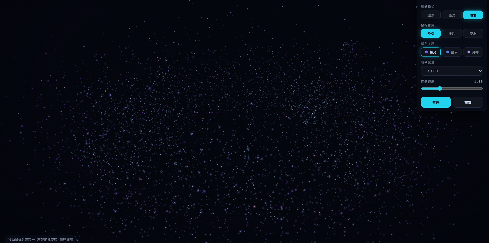

# Particle Playground · 3D 粒子互动实验室



> 截图为运行实况：12,000 粒子、爆发模式、极光主题，右上为可交互控制面板。

用 **Vite + TypeScript + Three.js** 从零搭建的浏览器粒子实验项目（阶段一：CPU 粒子运动）。
目标是把每个概念做小做清晰，方便逐步理解 Web3D 渲染管线，而不是一次性上 GPU Compute。

## 快速开始

```bash
npm install      # 安装依赖（首次）
npm run dev      # 启动开发服务器 → 打开 http://localhost:5173/
npm run build    # 类型检查 + 生产构建（输出 dist/）
npm run preview  # 本地预览 dist 产物
npm run typecheck
```

## 操作方法

| 操作 | 效果 |
| --- | --- |
| 移动鼠标 | 影响区域内粒子受鼠标力（吸引 / 排斥 / 旋涡可切换） |
| 左键拖拽 | OrbitControls 旋转相机（此时鼠标力暂停，互不打架） |
| 滚轮 | 缩放视角 |
| 右侧面板 | 运动模式 / 鼠标作用 / 颜色主题 / 粒子数量 / 速度 / 暂停 / 重置 |
| 空闲 12 秒 | 相机自动缓慢旋转（任何交互立即恢复手动控制） |

左上角 HUD 显示真实统计：FPS（每 0.5s 用帧计数结算，不写死）、粒子数、运行状态。

## 项目结构与每个文件的职责

```
particles/
├─ index.html               页面骨架：canvas + HUD + 控制面板 + 失败提示
├─ vite.config.ts           Vite 配置（base/端口/构建目标）
├─ src/
│  ├─ main.ts               入口：组装模块、主循环（交互→物理→渲染→统计）、清理
│  ├─ config.ts             全部调参常量（受力、半径、数量选项），调手感就改这里
│  ├─ types.ts              共享类型（MotionMode / MouseMode / ThemeName）
│  ├─ themes.ts             三个颜色主题 + 粒子渐变色采样算法
│  ├─ SceneManager.ts       场景/相机/渲染器/OrbitControls/星空/resize/资源释放
│  ├─ ParticleSystem.ts     核心：BufferGeometry + Points + 着色器 + CPU 物理循环
│  ├─ PointerInteraction.ts 鼠标像素坐标 → NDC → 射线 → 3D 平面交点 + 强度平滑
│  ├─ Panel.ts              控制面板与 HUD 的 DOM 绑定（UI 与系统解耦）
│  └─ style.css             深色科技风样式（HUD/面板/暗角/主题变量）
```

## 核心原理（学习重点）

### 1. 粒子数据的摆放：SoA 平行数组

每个粒子一行，所有粒子放在几个 `Float32Array` 里（而不是对象数组）：

```
pos = [x0,y0,z0, x1,y1,z1, ...]   位置
vel = [...]                       速度
home = [...]                      该粒子的“归宿位”（弹簧锚点）
size/alpha/phase = [...]          渲染表现
```

好处：内存连续、CPU 缓存友好、5000~12000 个粒子的每帧更新只有标量运算，
循环里**不 new 任何对象**——这是帧率稳定、GC 干净的关键。

### 2. 每帧更新循环（ParticleSystem.update）

```
读 pos/vel → 叠加自然模式的力 → 叠加鼠标力
→ 全局阻尼 v *= e^(-damping·dt)   ← 用指数形式，帧率无关
→ 限速（防瞬间被打飞）
→ px += vx·dt 积分位置
→ 写回数组，标记 position.needsUpdate = true 交给 GPU 重传
```

三种自然模式只是“力的配方”不同，位置从不被直接瞬移：
- **漂浮**：弱弹簧把粒子拴在 home 上 + 绕 home 公转的正弦摆动 → 萤火虫游动感；
- **漩涡**：绕 Y 轴切向力（越靠中心越快）+ 轻微向心 → 星系感；
- **爆发**：周期性给*速度*注入径向脉冲 → 阻尼减速 → burst 弹簧拉回 → “呼吸”循环。

因为模式切换只改受力、不改位置，所以任何切换都是平滑过渡。

### 3. 鼠标如何影响 3D 粒子（坐标转换）

浏览器只给我们 `clientX/clientY`（2D 像素）。转换链：

```
像素 → NDC((-1..1)) → Raycaster.setFromCamera 发一条射线
射线 ∩ 平面（过场景中心、垂直于相机视线）→ 得到 3D 影响点 (mouseX/Y/Z)
```

关键点：平面**法线取相机视线方向**，所以旋转相机后影响点始终跟着视线走，
而不是钉死在 z=0 平面上。随后 `ParticleSystem` 只对半径
`MOUSE.radius` 内的粒子按 smoothstep 衰减施加力（吸引=朝鼠标推，排斥=反推，
旋涡=绕“视线轴×指向粒子方向”的切向力）。

`PointerInteraction.strength` 是 0..1 的指数平滑值：进入画布渐强、移出或
拖拽相机时渐弱，保证交互开始/结束都没有跳变。

### 4. 为什么渲染一个 Points 就够了

`THREE.Points` 用一次 draw call 画全部粒子；每个粒子的尺寸/颜色/透明度/相位
通过 `BufferAttribute`（aSize/aColor/aAlpha/aPhase）传给自定义 `ShaderMaterial`：
- 顶点着色器：透视尺寸衰减 `size / -mvPosition.z` + 按相位呼吸的闪烁；
- 片元着色器：`gl_PointCoord` 算圆点 + 平方衰减柔边光晕，加色混合（AdditiveBlending）形成发光感；
- 闪烁/衰减全部发生在 GPU，CPU 每帧只写一份 position。

## 调参速查（改 src/config.ts）

| 想改什么 | 常量 |
| --- | --- |
| 粒子分布半径/厚度 | `CLOUD.radius / height` |
| 漂浮漂动感 | `MOTION.drift`（力度）、`MOTION.spring.float`（拴得松紧） |
| 漩涡转速 | `VORTEX.strength`（还有 inner/sink/wobble） |
| 爆发强度与节奏 | `BURST.speed / interval` |
| 鼠标影响半径/力度 | `MOUSE.radius / attract / repel / vortex` |
| 全局“跟手”速度 | `MOTION.damping`（越大动作越利落） |
| 粒子显示大小 | `RENDER.sizeScale` |
| 可选粒子数量 | `COUNT_OPTIONS` |

加一种新运动模式：在 `ParticleSystem.update` 的 `if/else` 里加一个分支，
在 `types.ts` + `index.html` 按钮组里加一个名字即可。

## 当前实现的边界

- 发光是柔边 sprite + AdditiveBlending 模拟，不是真正的 Bloom 后处理；
- CPU 循环 1.2 万粒已很流畅，但更大规模请升级到 GPU Compute（见下）；
- 触屏设备：单指仍会旋转相机（OrbitControls 默认），粒子交互以 tap 为主。

## 下一步：CPU → TSL / WebGPU 的升级路径

1. **先做 TSL 材质**（无需 WebGPU）：把本项目的 `ShaderMaterial`
   换成 `three/webgpu` 的 `MeshBasicNodeMaterial`，用 TSL 节点
   （`Fn`、`uniform`、引擎预设 `positionLocal` 等）重写顶点/片元逻辑，
   其余代码不变——这是熟悉 TSL 心智模型的第一步。
2. **准备 Compute 管线**：装 `three/webgpu` 的 `WebGPURenderer`，
   把 `pos/vel/home` 变成 `StorageBuffer` / `InstancedArrayAttribute`，
   相机/控制/UI 全部复用。
3. **把 update 循环翻译成 TSL compute**：每个粒子一个线程，
   在 kernel 里重写第 2 节的“力 → 阻尼 → 积分”，随后即可跑
   10 万+ 粒子的实时模拟。
4. **进阶体验**：curl noise 流场、空间哈希最近邻排斥、
   UnrealBloomPass 后处理发光。
